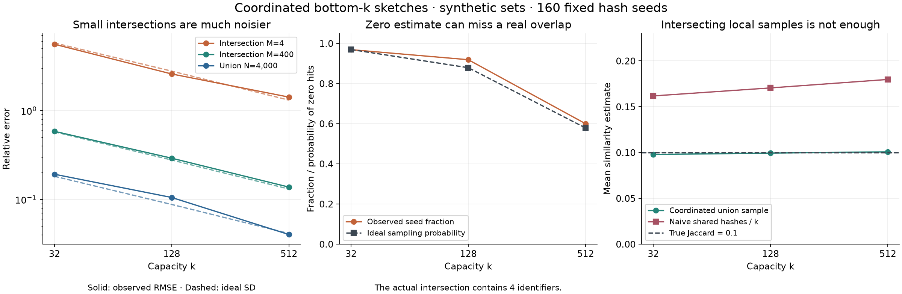

# Coordinated overlap sketches

[](https://github.com/lcx0731/coordinated-overlap-sketches/actions/workflows/ci.yml)

**Count distinct identifiers and estimate overlap while retaining only a small
sample of fingerprints.** The same configuration produces summaries that can be
merged across partitions, replayed without double counting, serialized, and
queried without the original identifiers.

The statistical question matters as much as the data structure: a sketch with
acceptable union error can have very large error for a small intersection.
Zero sampled matches need not mean disjoint sets. This project implements a
coordinated bottom-k sketch and demonstrates both issues using reproducible
synthetic data.

It combines streaming algorithms, distributed aggregation semantics, statistical
error analysis, and independent reference checks. The methods are established;
the implementation, fixtures, tests, and diagnostics here are original project
work, not a claim of a new estimator. The core and CLI use only Python's standard
library. NumPy, Matplotlib, and pytest are optional experiment/test dependencies.



## Reproduce

Use Python 3.11 or newer:

```bash
git clone https://github.com/lcx0731/coordinated-overlap-sketches.git
cd coordinated-overlap-sketches
python3 -m venv .venv
source .venv/bin/activate
python -m pip install '.[test]'
python -m pytest -q
overlap-sketch-demo --output results
overlap-sketch compare results/left.json results/right.json
```

The demo writes `summary.json`, `left.json`, `right.json`, and
`overlap-diagnostics.png` under the chosen directory, replacing those names if
they exist. It generates all data locally and downloads nothing. Choose another
output directory to preserve the checked-in results. For the dependency versions
used for these artifacts, run on **Python 3.13**:

```bash
python -m pip install -r requirements-repro.txt
python -m pip install --no-deps .
python -m pip check
```

The ordinary install uses version ranges in `pyproject.toml`; CI tests and runs
the complete demo on Python 3.11 and 3.13. Last digits of floating-point summaries
and image rendering may vary across dependency versions and platforms.

## Streaming API and CLI

```python
from overlap_sketch import Config, Sketch, compare

config = Config(k=128, seed=7)  # 128-bit fingerprints by default
left = Sketch(config).update(["alice", "bob", "alice"])
right = Sketch(config).update(["bob", "carol"])
result = compare(left, right)
assert result.union_estimate == 3
assert result.intersection_estimate == 1

merged = left.merge(right)  # returns a new sketch
restored = Sketch.loads(merged.dumps())
assert restored.dumps() == merged.dumps()
```

For user-supplied line-delimited identifier files:

```bash
overlap-sketch build left-ids.txt --k 128 --seed 7 --output left-sketch.json
overlap-sketch build right-ids.txt --k 128 --seed 7 --output right-sketch.json
overlap-sketch merge left-sketch.json right-sketch.json --output union-sketch.json
overlap-sketch compare left-sketch.json right-sketch.json
```

Each UTF-8 line is one identifier. Newline delimiters are removed; spaces and
empty lines are meaningful. Unicode normalization and case folding are **not**
performed. This defines distinctness by exact string contents, not by person,
account, spelling variant, or event frequency. The CLI reads incrementally and
does not keep the input file in memory. Output files are replaced if already
present; input/output aliases, including existing hard links, are rejected.
Errors exit with status 2 and an explanation.

## How the sketch works

For each identifier, compute a deterministic BLAKE2b fingerprint using an
eight-byte public seed and a fixed personalization string. The default retains
the full 128 bits. Integer ordering of fingerprints is exact. A max-heap and set
hold the `k` smallest **distinct** fingerprints seen so far.

- A repeated identifier changes nothing.
- Before more than `k` distinct fingerprints have appeared, all are retained.
  The estimate is their exact count in the **hash domain**.
- Once a new distinct fingerprint exceeds capacity, an overflow flag remains
  set. The largest retained rank is used only as a threshold, leaving `k-1`
  ranks for estimation.
- Merging takes the `k` smallest ranks in the union of the two retained sets,
  preserving overflow information. No discarded rank can enter the global
  bottom-k: at least `k` smaller ranks already preceded it in its source.

Configurations must match exactly: format version, `k`, seed, and bit width.
Mixed configurations are rejected, even where a more general sketch framework
could support them. Merge is commutative, associative, and idempotent for
compatible sketches, and leaves its inputs unchanged.

### Coordinated intersection

First form the bottom-k sketch of the **union**. If overflowing, let `H` be its
kth-smallest integer fingerprint, set `tau = (H+1)/(2**bits+1)`, and exclude `H`
from the sample. Otherwise use all ranks and `tau=1`.

Every sampled union fingerprint is present in each source sketch whose hashed
set contains it: the union threshold is no larger than either source's kth
rank. Let `r` be the union sample size and `C` the number of sampled fingerprints
present in both source sketches. Return:

```text
union estimate        = r / tau
intersection estimate = C / tau
Jaccard estimate      = C / r
```

For two empty inputs the Jaccard convention is 1. In estimation mode `r=k-1`.
The threshold fingerprint is never counted in `r` or `C`. The open rational grid
avoids division by zero; conversion to float64 can still round at the upper
endpoint. Reported counts are estimates and are not rounded or clamped to the
number of retained fingerprints.

The ratio `|local_sample_A ∩ local_sample_B| / k` is a tempting but generally
incorrect Jaccard estimate. Local samples can have different thresholds, and
even equal-capacity, equal-size sources do not share the union's cutoff. The
demo includes this deliberately naive comparison.

`compare` returns estimates and diagnostic counts, **not** a new intersection
sketch. This is a narrow union/intersection query implementation, not support
for arbitrary nested set expressions or weighted items.

## Ideal sampling benchmark

The following statements assume independent continuous Uniform(0,1) ranks and
fixed sets selected independently of those ranks. They are not exact guarantees
for deterministic finite-width hashes.

Write `N = |A ∪ B|`, `M = |A ∩ B|`, and suppose `N > k >= 3`. The kth order
statistic `T` has distribution `Beta(k, N-k+1)`. The labels of the first `k-1`
items form a uniform sample without replacement from the union, independently
of `T`. Hence `C` is hypergeometric with population size `N`, marked count `M`,
and draw size `k-1`.

```text
E[1/T]   = N / (k-1)
E[1/T²]  = N(N-1) / ((k-1)(k-2))
E[C/T]   = M
Var(C/T) = M(N-k+1) / (k-2)
P(C=0)   = choose(N-M, k-1) / choose(N, k-1)
```

The numerator in the last formula is zero if too few unmarked items exist.
For the union, substitute `M=N`. For Jaccard, `E[C/(k-1)] = M/N`. If `N<=k`,
the collision-free sketch retains the whole set and sampling variance is zero.

The relative standard deviation of the intersection estimate is
`sqrt((N-k+1)/((k-2)*M))` for `M>0`. It grows as the intersection shrinks, even
when union error is small. Tests independently enumerate small label subsets
and integrate inverse moments using rational beta-function factorials to check
these formulas. The reference takes **known true** `N,M`; it is an experimental
benchmark, not an uncertainty interval fitted from a sketch.

## Results from the checked-in experiment

All identifiers are synthetic strings generated by `demo.py`. The seed sweep
uses seeds **0–159**, union size **4,000**, intersection sizes **4 and 400**, and
capacities **32, 128, 512**. No seeds or runs are discarded. Each row below uses
160 deterministic hash configurations; this finite sweep is a diagnostic, not
a proof of hash independence or unbiasedness.

| Capacity | Union relative RMSE | Intersection relative RMSE, M=4 | Zero-hit fraction, M=4 | Ideal zero-hit probability |
| ---: | ---: | ---: | ---: | ---: |
| 32 | 0.1918 | 5.5606 | 0.96875 | 0.96935 |
| 128 | 0.1050 | 2.5751 | 0.91875 | 0.87888 |
| 512 | 0.0402 | 1.4145 | 0.60000 | 0.57872 |

Relative RMSE means `sqrt(mean((estimate-truth)**2))/truth`, so it can exceed
one. With `k=128`, a real four-item intersection was missed in **147 of 160**
runs. Its mean estimate was **2.9243**, below the true count of 4. These observed
finite-sweep discrepancies are retained in the report rather than presented as
exact agreement with the ideal expectation. `relative_mean_error` in the JSON
is the sweep mean divided by truth minus one, not a proven estimator bias.

For the 400-item intersection, true Jaccard is 0.1. At `k=128`, the coordinated
estimate averaged **0.09931**, while the naive local-sample ratio averaged
**0.17046**. The figure's solid error curves are observed RMSE; dashed curves
are ideal standard deviations. The same underlying union is used for both
overlap sizes, so their union estimates coincide at a given seed and capacity.

### Merge and replay audit

The separate ingestion example processes **11,667 events**, containing **5,000
distinct identifiers**, across eight partitions. Merging partitions in reverse
order produces byte-identical serialized state to one-pass ingestion; replaying
a partition also leaves the state unchanged. The result retains 128 fingerprints
and estimates 4,871.927 distinct items. Its JSON representation is **4,564
bytes**. This is serialized size, not Python process memory or a compression
ratio against any particular raw-file encoding.

### Hash collisions are a separate failure mode

Two disjoint 300-item sets are processed without sampling truncation (`k=1024`).
Deliberately projecting fingerprints to 8 bits gives a union count of **227**
and a false intersection of **117** in the hash domain. The 128-bit run for
this fixture returns union 600 and intersection 0.

Both runs report `exact_hash_domain=true`: no fingerprint was discarded. That
flag does **not** assert collision-free counting of original identifiers.
The sketch cannot recover identities lost to a collision or detect all such
collisions. Low bit widths are included to make the issue visible; keep the
default 128 bits for ordinary experiments.

## Verification, cost, and boundaries

- Full-set reference sorting checks streaming and merge outputs on 16 seeded
  datasets, including duplicates, imbalanced source sizes, and deliberately
  small hash domains. Additional tests cover exactness at capacity, algebraic
  merge laws, persistence/resume, deterministic hash protocol vectors, zero
  hits despite actual overlap, and collision-induced false matches.
- Serialization validates fields, format version, rank order, uniqueness,
  width, overflow consistency, and duplicate JSON keys. This catches malformed
  state; it does not authenticate provenance or detect every valid-looking
  edit. All sketches must come from the same identifier encoding protocol.
- Storage is `O(k)` fingerprints, with a heap and set plus object overhead.
  Hashing costs linear time in identifier byte length; an admitted rank costs
  `O(log k)` heap work. Merge/query use `O(k)` temporary storage and
  `O(k log k)` sorting/selection work. Full-set references and synthetic demo
  generators intentionally materialize data and do not have the streaming
  memory bound. A bad item partway through an API `update` can leave earlier
  items ingested; updates are not transactions.
- The implemented estimator applies a continuous-rank formula to a finite
  hash grid. Finite-grid bias, collisions, floating-point conversion, and
  non-independent/adversarial identifiers are outside the ideal proof. A
  BLAKE2b seed sweep is not a distribution-free confidence guarantee. No
  confidence intervals or adversarial accuracy guarantees are implemented.
- A zero estimated intersection is **not a disjointness certificate** in
  sampling mode. Adaptive subset selection after inspecting fingerprints can
  invalidate the fixed-set benchmark. The tool estimates sets, not event
  frequencies, weighted populations, rolling windows, or deletions.
- Fingerprints and public seeds are sufficient to test guessed identifiers;
  this format is not an anonymization mechanism.

## References

[Cohen and Kaplan, *Bottom-k sketches* (2007)](https://research.google/pubs/bottom-k-sketches-better-and-more-efficient-estimation-of-aggregates/)
and their [2008 estimation paper](https://www.vldb.org/pvldb/vol1/1453884.pdf)
provide background on coordinated sampling and subset estimation.
[Apache DataSketches' Theta overview](https://datasketches.apache.org/docs/Theta/ThetaSketches.html)
and [set-operation corner cases](https://datasketches.apache.org/docs/Theta/ThetaSetOpsCornerCases.html)
explain related practical concepts. This project's `k` counts **all stored
ranks, including the threshold rank** in estimation mode, so its `k-1` sample
convention must not be substituted into another library's nominal-size formulas.
It does not use the DataSketches implementation or serialization format.

Released under the [MIT License](LICENSE).
